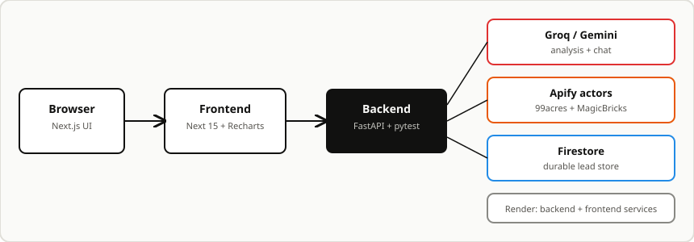

# LeadAnalyzer

AI powered lead triage for property agents. Paste in a customer inquiry and get an
instant read: who is hot, what is blocking the deal, what to do next, and what to reply.


## What it does

1. **Lead intake.** A form captures name, location, property requirement, budget,
   buying timeline, and the raw customer message. Bulk import accepts pasted rows.
2. **AI analysis.** Every lead is analyzed by Groq with Gemini fallback: summary,
   intent, requirements, objections, next action, suggested reply, hot/warm/cold
   priority, and a decision maker flag.
3. **Grounded chat.** Ask follow up questions about one lead or the whole pipeline.
   Answers use the stored records only. Off topic questions are refused.
4. **Prioritized pipeline.** All leads are ranked hot first with filters, search,
   and an admin mode (type `tetrax` in the filter box) for editing and deletion.
5. **Live property search.** Indian listings are scraped on demand with Apify
   (99acres and MagicBricks actors) and cached for instant repeats.
6. **Call transcripts.** Upload a sales call recording, get a transcript plus
   suggested actions, and create a lead from it in one click.
7. **Durable storage.** Leads live in Firestore, so nothing is lost on restarts.



## Quickstart

### Backend

```bash
cd backend
python3 -m venv .venv
source .venv/bin/activate
pip install -r requirements.txt
cp ../.shared.env ../.env   # then fill in real keys
uvicorn app.main:app --reload --port 8011
```

Backend health check: `GET http://127.0.0.1:8011/health`

### Frontend

```bash
cd frontend
npm install
cp .env.local.example .env.local  # or export the vars below
NEXT_PUBLIC_BACKEND_URL=http://127.0.0.1:8011 npm run dev -- -p 3000
```

Open `http://localhost:3000`.

### Run tests

```bash
cd backend && python -m pytest
cd frontend && npm run test
```

## Environment variables

| Variable | Where | Purpose |
| --- | --- | --- |
| `GROQ_API_KEY` | backend | Primary LLM for analysis and chat |
| `GEMINI_API_KEY` | backend | Fallback LLM when Groq fails |
| `APIFY_API_TOKEN` | backend | Live property scraping |
| `BACKEND_URL` | backend | Public backend URL (Render) |
| `FRONTEND_URL` | backend | Allowed CORS origin |
| `NEXT_PUBLIC_BACKEND_URL` | frontend | Backend URL baked into the build |
| `NEXT_PUBLIC_FIREBASE_*` | frontend | Firebase web config (public by design) |

Copy `.shared.env` to `.env` for local runs. Never commit `.env`.

## API overview

| Method | Path | Purpose |
| --- | --- | --- |
| GET | `/health`, `/status` | Health and provider status |
| GET/POST | `/leads` | List (with `?q=`) and create leads |
| GET/PUT/DELETE | `/leads/{id}` | Read, edit (re-analyzes), delete |
| GET | `/leads/stats` | Pipeline analytics |
| POST/GET | `/leads/{id}/chat` | Grounded follow up chat and history |
| POST | `/chat` | Pipeline wide assistant (leads only) |
| GET/POST | `/properties/search` | Live and cached listings |
| POST/GET | `/properties/search/jobs` | Background multi platform scrape |
| GET | `/properties/suggest` | Location autocomplete with typo fixes |
| POST/GET | `/transcripts` | Call upload, history, and actions |

## AI models and how they are called

- **Groq** (`openai/gpt-oss-20b`) is the primary model. Lead analysis requests
  JSON (`response_format: json_object`) with a low temperature for stable
  triage. Chat uses plain text completions grounded in the stored lead record.
- **Gemini** (`gemini-3.8-flash`) is the automatic fallback. Every AI call tries
  Groq first and retries once on Gemini before surfacing an error, so a single
  provider outage never blocks intake or chat.
- **Apify** powers live property search. Indian queries run 99acres and
  MagicBricks actors in parallel background jobs, US queries run a Zillow
  actor. Results are normalized, stored, and served instantly on repeats.
- The pipeline wide assistant (`POST /chat`) is prompt fenced to leads only.
  Off topic questions get a one sentence refusal that steers back to the pipeline.

## Key technical decisions

- **Backend owns AI and truth, frontend owns speed.** All model calls happen
  server side. The browser keeps a localStorage cache with stale while
  revalidate, so pages paint instantly and refresh quietly.
- **Firestore is the durable store, memory is the hot store.** Leads load from
  Firestore on boot and every write mirrors there. There are no JSON seed
  files left in the repo.
- **Mock API routes mirror every backend endpoint.** The frontend works fully
  offline against built in demo data when no backend URL is configured.
- **Background jobs for slow scrapes.** Apify runs take minutes, so search
  starts a job and the UI polls for progressive results instead of blocking.
- **One Render blueprint.** `render.yaml` defines both services so the whole
  project deploys from a single Blueprint launch.

## Known limitations

- Call transcription does not work on the deployed site. The Render free plan
  has limited CPU and transcription times out there. Run the backend locally
  (`uvicorn app.main:app --reload --port 8011`) to use the Calls page.
- Live property search takes one to three minutes on a cold query while Apify
  actors run. Repeats are instant from the store.
- Actor coverage varies by city. Obscure localities can return zero rows, in
  which case the UI says so honestly.
- AI analysis quality depends on the providers. Garbage model output is caught
  and surfaced as an analysis error instead of a fake triage.
- Firestore rules in this repo are open for development. Tighten them before
  any production use.
- The in memory backend store resets on redeploy. Firestore restores leads,
  but chat histories do not persist across restarts.

## Project structure

```text
backend/            FastAPI app (routes, services, store, tests, scripts)
frontend/           Next.js app (pages, components, lib, mock API, tests)
docs/               Diagrams and notes
firestore.rules     Firestore rules for development
render.yaml         Render blueprint (backend plus frontend)
.shared.env         Template of required env vars (no secrets)
```

## Deploy on Render (one service)

The repo ships a `render.yaml` blueprint that deploys backend and frontend as
a single Render web service. `build.sh` installs Python deps, fetches Node,
and builds Next.js. `server.py` then runs both processes: Next.js serves
public traffic on `$PORT` and FastAPI listens internally, reachable by the
browser through the `/live` prefix.

Manual settings if you skip the blueprint:

- **Root Directory:** repo root (leave empty)
- **Runtime:** Python 3
- **Build Command:** `bash build.sh`
- **Start Command:** `python server.py`
- **Health Check Path:** `/`

Set the secret env vars and deploy. You do not need to know any URL upfront:
there is only one service, so frontend and backend share its URL, and the
backend reads Render's own `RENDER_EXTERNAL_URL` for CORS automatically.
Set `FRONTEND_URL` only if you ever need to override that.
